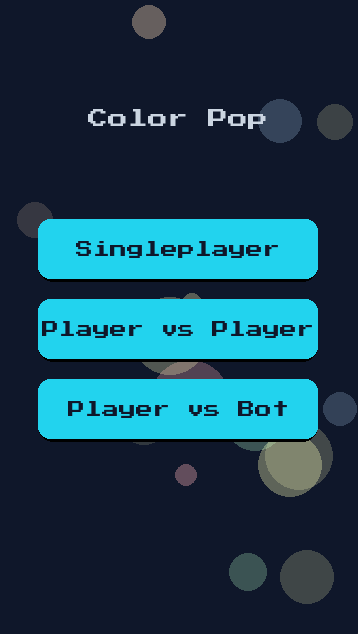
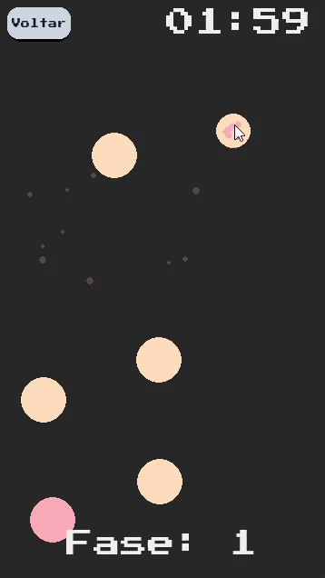
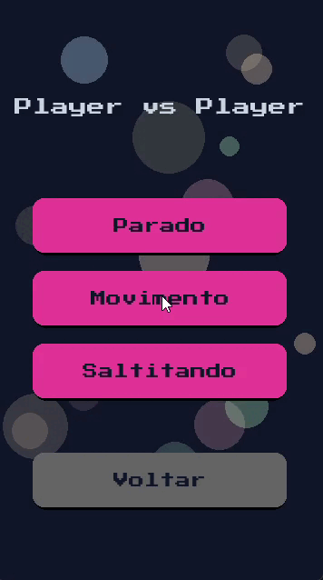

<div align="center">

# 🎮 Color Pop Game

**Um puzzle arcade viciante feito com React + Next.js + Tailwind — iguale todas as cores antes do tempo acabar.**

[](https://nextjs.org/)
[](https://react.dev/)
[](https://tailwindcss.com/)
[](https://www.typescriptlang.org/)
[](./LICENSE)

[✨ Jogar](#-rodando-o-projeto) · [🎯 Modos de jogo](#-modos-de-jogo) · [🧠 Decisões técnicas](#-decisões-técnicas) · [📁 Arquitetura](#-arquitetura)

</div>

---

## 👀 Visão geral

> Clique nas bolinhas para alternar entre 2 cores. Vença a fase quando **todas na sua área tiverem a mesma cor**. Simples de aprender, difícil de largar.

<!-- TODO(portfolio): adicionar screenshots/GIFs atuais do jogo -->
<!-- | Menu principal | Singleplayer | PvP local |
|---|---|---|
|  |  |  | -->

**Destaques do projeto:**

- ⚡ Game loop a **60fps em Canvas 2D** com `requestAnimationFrame` — sem engine externa
- 🧩 **3 modos** (singleplayer, PvP local, vs Bot com IA) × **3 físicas** (parado, movimento, gravidade)
- 📈 Dificuldade procedural: `6 + 2 bolas/fase`, velocidade e gravidade escalonadas
- 🏆 Recordes persistidos em `localStorage` + partículas, sons e HUD reativo
- 🧱 Código **portfoliável**: TypeScript strict, lógica pura separada da UI, componentes desacoplados

---

## 🎯 Modos de jogo

| Modo | Regra | Duração |
|---|---|---|
| **Singleplayer** | Faça o máximo de fases em 120s | ⏱️ 120 segundos |
| **Player vs Player** | Tela dividida, quem fecha a cor primeiro pontua | 🏁 Melhor de 10 fases |
| **Player vs Bot** | Sua área é a de cima; a IA joga embaixo a cada 1.2s | 🏁 Melhor de 10 fases |

**Físicas:** `Parado` (estratégia pura) · `Movimento` (quique livre) · `Saltitando` (gravidade + pulo).

---

## 🚀 Rodando o projeto

> `npm run dev` **abre o navegador automaticamente** em `http://localhost:3000`.

```bash
npm install
npm run dev        # abre o navegador sozinho ✅
```

| Comando | O que faz |
|---|---|
| `npm run dev` | Dev server **+ abre o navegador** (terminal fica preso) |
| `npm run dev:no-open` | Dev server sem abrir o navegador |
| `npm run build` | Build de produção |
| `npm start` | Produção **+ abre o navegador** |
| `npm run lint` / `npx tsc --noEmit` | Lint + typecheck |

Para desativar a abertura automática uma vez: `NO_OPEN=1 npm run dev` (ou `BROWSER=none`).

### 🔁 Rodar em segundo plano (start / stop / restart)

Estes comandos sobem a aplicação **desacoplada do terminal**, abrem o navegador
sozinho e permitem parar/reiniciar depois:

| Comando | O que faz |
|---|---|
| `npm run app:start` | Sobe em segundo plano e **abre o navegador** |
| `npm run app:start:prod` | Igual, mas em modo produção (requer `npm run build`) |
| `npm run app:stop` | Para a aplicação |
| `npm run app:restart` | Reinicia no mesmo modo e porta |
| `npm run app:status` | Mostra URL, PID, modo e se o HTTP responde |
| `npm run app:open` | Apenas reabre o navegador na app que está rodando |

No Windows também dá para **dar duplo clique** em `start.bat`, `stop.bat`,
`restart.bat` e `status.bat` na raiz do projeto.

Detalhes:

- Se a porta `3000` estiver ocupada (por outro projeto, por exemplo), a próxima
  porta livre é escolhida automaticamente e mostrada no terminal.
- Ajuste manual: `npm run app:start -- --port 4000` ou `start.bat --port 4000`.
- Para não abrir o navegador: `npm run app:start -- --no-open`.
- O estado fica em `.app.pid` e os logs em `.app.log` (ambos no `.gitignore`).

---

## 🧠 Decisões técnicas

- **Canvas em vez de DOM/SVG para as bolas:** dezenas de entidades a 60fps sem custo de reconciliação do React. O React cuida de menus/HUD; o Canvas do loop do jogo.
- **Lógica pura em `src/lib/game-logic.ts`:** criação de fases, spawn sem sobreposição, física, IA e condição de vitória são funções puras/testáveis, sem dependência de React.
- **Estado fora do React no loop:** o `GameCanvas` mantém mutação em `ref` + `requestAnimationFrame` para evitar re-renders por frame.
- **Recordes em `localStorage`:** chave `color-pop:records:v1`, com fallback silencioso para SSR/modo privado.

---

## 📁 Arquitetura

```
src/
├── app/                  # Next.js App Router
│   ├── layout.tsx        # Layout raiz + metadata
│   ├── page.tsx          # Home → GameShell
│   └── globals.css       # Tailwind v4
├── components/
│   ├── game/
│   │   ├── GameShell.tsx  # Máquina de telas: menus → playing → end/victory
│   │   └── GameCanvas.tsx # Loop 60fps, física, IA, partículas, input
│   └── ui/
│       └── MainMenu.tsx   # Menus principal / single / pvp / pve
├── lib/
│   ├── config.ts          # Constantes de gameplay (tela, física, cores)
│   └── game-logic.ts      # Fases, bolas, colisão, IA, vitória
├── hooks/
│   └── useRecords.ts      # Recordes em localStorage
└── types/
    └── game.ts            # GameMode, BallBehavior, BallEntity, Bounds
public/
├── sounds/               # bubble_pop.wav, ui_click.wav, ui_hover.wav, bg music
└── fonts/                # ModernFont.ttf, PixelFont.ttf
docs/screenshots/         # Prints e GIFs usados acima
scripts/
├── run-with-open.mjs     # Dev/prod + abertura automática do navegador
└── app.mjs               # start/stop/restart/status em segundo plano
start.bat / stop.bat / restart.bat / status.bat  # atalhos no Windows
```

---

## 🗺️ Roadmap

- [ ] Sprites WebAudio + música de fundo com toggle real
- [ ] Leaderboard global (Vercel KV)
- [ ] Temas + modo daltônico
- [ ] PWA/offline + tuning de touch no mobile
- [ ] Testes Vitest para `game-logic.ts`

---

## 👨‍💻 Autor

Feito por **Jonata** — desenvolvedor focado em front-end moderno (React, Next.js, TypeScript).

- GitHub: [@seu-usuario](https://github.com/seu-usuario) <!-- troque pelo seu perfil -->
- LinkedIn: [seu-perfil](https://www.linkedin.com/in/seu-perfil) <!-- troque pelo seu perfil -->

Se curtiu, deixa uma ⭐ no repositório!

## 📄 Licença

Distribuído sob a licença **MIT**. Veja `LICENSE` para detalhes.
